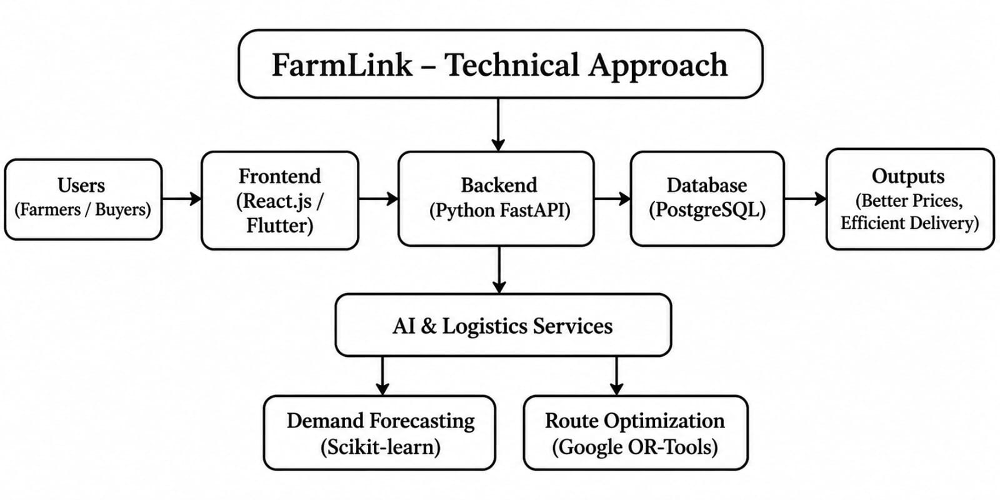

# Smart India Hackathon Workshop
# Date: 24/11/2026
## Reference Number: 26019014
## Name: Akshaya Needhi N

## Problem Title
SIH 26033: Multiple intermediaries reduce farmers earnings and increase consumer prices.

## Problem Creater's Organization
Ministry of Consumer Affairs, Food & Public Distribution

## Theme
Agriculture, FoodTech & Rural Development

## Problem Description
Expected Solution: Create a digital marketplace that:

• Connects farmers/FPOs directly with consumers and bulk buyers.
• Provides logistics support.
• Uses AI for demand forecasting and route optimization.

Benefits:

• Better prices for farmers.
• Lower prices for consumers.
• Reduced supply chain inefficiencies.

## Proposed Solution
FarmLink is a digital marketplace that directly connects farmers with consumers, retailers and bulk buyers, eliminating unnecessary intermediaries in the agricultural supply chain.

The platform provides:

* Direct Marketplace: Farmers can list their products and sell directly to buyers at fair prices.

* AI Demand Forecasting: Predicts future demand using historical sales, seasonal trends and weather data.

* Smart Logistics: Connects farmers with delivery partners and optimizes transportation routes.

* Order Tracking: Enables buyers to track products from farm to destination.

* Price Transparency: Displays product prices and transportation charges clearly.

## Technical Approach

## Feasibility and Viability

* Uses existing technologies and open-source tools, making development affordable.

* Can initially be implemented in selected villages or agricultural regions.

* Supports smartphones and multilingual interfaces for easy farmer accessibility.

* Can partner with FPOs, local transport providers and agricultural cooperatives.

* Revenue can be generated through small transaction fees, logistics commissions and bulk-buyer subscriptions.

* Can be scaled to multiple regions based on demand and availability.

## Impact and Benefits
For Farmers:

* Better prices and increased earnings.

* Direct access to consumers and bulk buyers.

* Reduced dependency on intermediaries.

* Better demand predictions and reduced unsold produce.

For Consumers:

* Lower purchasing costs.

* Access to fresh agricultural products.

* Transparent pricing and product information.

For the Supply Chain:

* Reduced transportation costs.

* Optimized delivery routes.

* Reduced food wastage.

* Improved supply chain efficiency.

* Better coordination between farmers, buyers and logistics providers.

## Research and References
1\. e-NAM (National Agriculture Market): Government of India's digital agricultural trading platform for transparent price discovery and improved market access. [https://enam.gov.in/](https://enam.gov.in/?utm_source=chatgpt.com) Home +1

2\. Ministry of Agriculture and Farmers Welfare: Information on digital agricultural marketing and farmer empowerment. [https://agriwelfare.gov.in/](https://agriwelfare.gov.in/?utm_source=chatgpt.com)

3\. FAO (Food and Agriculture Organization): Research and resources on reducing food loss and improving agricultural supply chains. [https://www.fao.org/](https://www.fao.org/?utm_source=chatgpt.com)

4\. Google OR-Tools: Open-source tools for vehicle routing and logistics optimization. [https://developers.google.com/optimization](https://developers.google.com/optimization?utm_source=chatgpt.com)

5\. Digitalization of Food Supply Chains: Research on using digital technologies to reduce food loss and improve supply chain efficiency. ScienceDirect +1